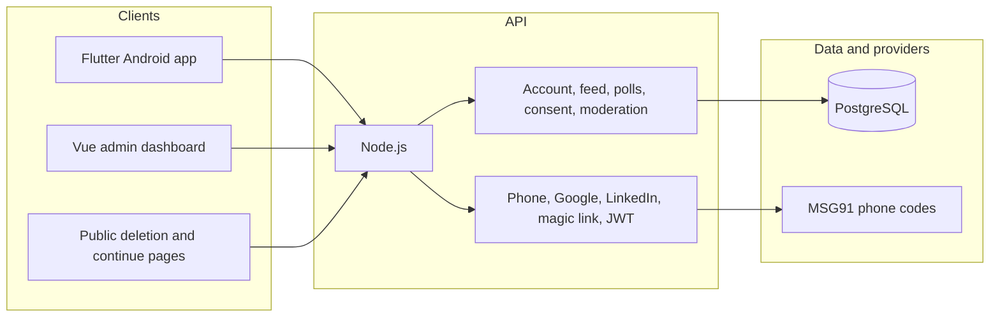

# Architecture

Employee Voice India is three clients of one API. The Android app and the admin dashboard never talk to Postgres directly. The running API is `backend/node`. `apps/api` and `apps/web` are Phase 1 skeletons and are not on this request path.

## Request path

1. A member signs in with a phone code, Google, or LinkedIn. Staff admin sign-in uses an email magic link. The API stores only a SHA-256 hash of the link identifier. Development phone codes are hashed in memory. Production phone codes are checked by MSG91 and are not stored here.
2. A valid sign-in returns a 15-minute access JWT and a refresh token. The access token carries `sub` and `sid` only.
3. Every authenticated request checks that the account is active and that the refresh session named by `sid` has not been revoked.
4. List endpoints use a sequence cursor. Writes that must stay consistent, including account deletion, run in a transaction.
5. Admin actions check a database role on each request. The Vue router only hides navigation.

## Provider boundaries

- Phone codes use MSG91 in production. The provider generates and checks the code. Development keeps a short-lived hash in memory and writes the code to the local mailbox. There is no password store and no production OTP table.
- Google ID tokens and LinkedIn authorization codes are checked with the provider. The API stores the provider subject, not a password.
- Push tokens can be stored on the notification preference row. Notification titles and bodies stay generic.

## What this design does not claim

Peers see a display name. Administrators, moderators, and people who operate the database, backups, and logs can still access data their role or infrastructure allows. Poll ballots are stored without a user id, and eligibility is stored without the chosen option, but a database operator can still correlate them through timing, backups, or a day on which only one person voted. That is not cryptographic anonymity.
