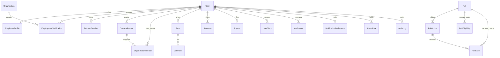

# Data model

Primary keys are UUIDs. Timestamps are UTC. Table and column names are snake_case. Foreign keys use `ON DELETE RESTRICT`. Enums are stored as strings.

`PollEligibility` stores the member and the poll. `PollBallot` stores the poll, the option, and the calendar date. There is no foreign key between those two tables. A check constraint requires `min_cohort >= 5`. Results are returned only after the poll is closed and at least five ballots exist.

`OrganizationInterest` is queried only by the member who recorded it and by administrators. It is not joined into the public feed.

Employment verification stores a method, a status, an optional email domain, and a reviewer note. Work-email addresses and employer names are scheduled for clearing. The API does not accept identity documents.

Public profile responses omit email, legal name, employer, and verification evidence. The account owner can still see their own email on `GET /api/v1/me`.
